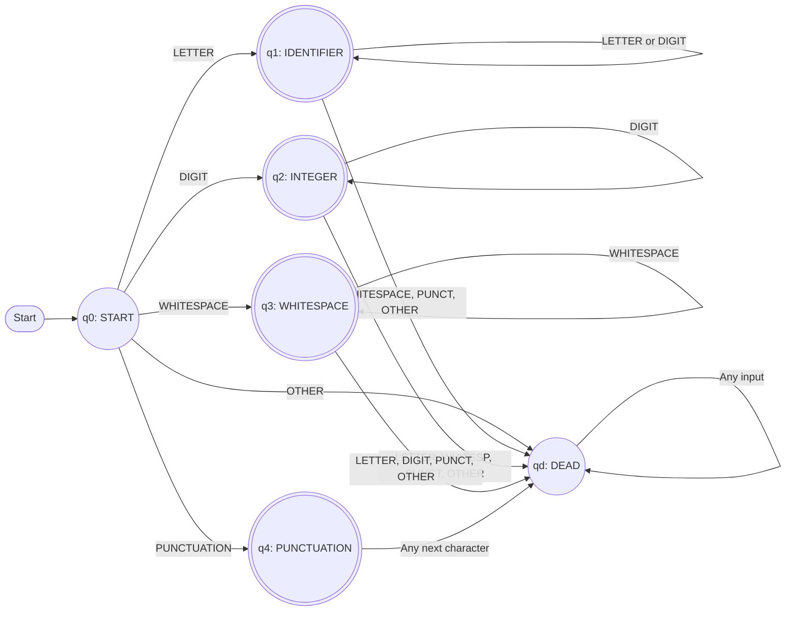

# Tokenizer State Machine (Mini Lexer)

**Theory of Computation (TOC) Course Project — Group 3**

---

## What is this project?

Whenever you send a prompt to an AI model like ChatGPT or Claude, the model doesn't process entire sentences all at once. Before any transformer or neural network gets involved, the input text has to be chopped into pieces called **tokens**.

The very first step of that process is **lexical analysis** using a **Deterministic Finite Automaton (DFA)**. The DFA scans through text character by character and groups them into basic categories: words, numbers, punctuation, and whitespace.

For our TOC project, we built a mini lexer in Python to understand how this works under the hood. Our state machine reads an input string, follows formal state transitions, detects token boundaries using the *Maximal Munch* rule, and tags each token with its type and character positions. We also built a web interface to visualize each state jump in real time, and compared our token counts against OpenAI's `tiktoken`.

---

## How Our DFA Works

Our lexer uses a 6-state automaton:

| State | Name | What it does | Accepting? |
| :--- | :--- | :--- | :---: |
| **q0** | `START` | Starting point; waits for the first character of a token | No |
| **q1** | `IDENTIFIER` | Collects letters, underscores, and trailing digits (words/variables) | Yes |
| **q2** | `INTEGER` | Collects numbers (0–9) | Yes |
| **q3** | `WHITESPACE` | Groups consecutive spaces, tabs, and newlines | Yes |
| **q4** | `PUNCTUATION` | Matches individual symbols and punctuation marks | Yes |
| **qd** | `DEAD` | Reached when a character doesn't fit the current pattern (signals a token boundary) | No |

### Character Classes
Before making a transition, the lexer sorts every character into one of five buckets:
- **`LETTER`**: `a`–`z`, `A`–`Z`, `_`
- **`DIGIT`**: `0`–`9`
- **`WHITESPACE`**: Spaces, tabs (`\t`), newlines (`\n`)
- **`PUNCTUATION`**: Common symbols (`;`, `=`, `!`, `?`, `(`, `)`, etc.)
- **`OTHER`**: Anything else (emitted safely as `UNKNOWN` so the program doesn't crash)

### State Diagram


When the DFA hits `qd` (Dead state), the lexer knows the current token has ended. It saves the token, steps back to `q0`, and begins scanning the next one.

---

## Team Contributions

We divided the work across 4 members:

- **Member 1 (DFA Logic & Theory):** Designed the state machine, mapped the character classes, created the transition table, and wrote up the formal specifications (`src/dfa.py`, `docs/transition_table.md`).
- **Member 2 (Lexer Implementation):** Wrote the scanner engine in Python, implemented token boundary detection and offset tracking, and built the unit test suite (`src/lexer.py`, `tests/test_lexer.py`).
- **Member 3 (Frontend & Visualizer):** Built the interactive Streamlit web app and the step-by-step state transition table (`app.py`, `src/visualizer.py`).
- **Member 4 (GPT Comparison & Testing):** Integrated OpenAI's `tiktoken` to compare our DFA outputs with actual LLM tokens, managed project dependencies, and ran evaluation tests (`src/comparison.py`, `requirements.txt`).

---

## Project Structure

```text
Tokenizer-State-Machine-Mini-Lexer/
├── app.py                     # Streamlit web app
├── requirements.txt           # Project dependencies
├── .gitignore                 # Cache ignore file
│
├── src/
│   ├── __init__.py
│   ├── dfa.py                 # States, character classes, transition rules
│   ├── lexer.py               # Tokenizer engine (scans text and emits tokens)
│   ├── visualizer.py          # Helpers to trace states and format tables
│   └── comparison.py          # Compares token counts with OpenAI's tiktoken
│
├── docs/
│   └── transition_table.md    # Full transition matrix and hand traces
│
└── tests/
    └── test_lexer.py          # 11 unit tests for edge cases and correctness
```

---

## How to Set Up and Run

### 1. Clone the repo and install dependencies
```bash
git clone https://github.com/keerthana-YB/Tokenizer-State-Machine-Mini-Lexer.git
cd Tokenizer-State-Machine-Mini-Lexer
pip install -r requirements.txt
```

### 2. Launch the Streamlit Web Demo
```bash
streamlit run app.py
```
This opens a local webpage where you can type any sentence or code snippet to see:
1. The **Token Table** (lexeme, token type, start/end character indices).
2. The **DFA Transition Trace** (shows every single character, which state it started in, and where it transitioned).

### 3. Run the Unit Tests
```bash
python -m pytest tests/test_lexer.py
```
Runs 11 test cases covering words, numbers, punctuation, multiple spaces, mixed identifiers like `count42`, and invalid symbols.

---

## Sample Walkthrough & GPT Comparison

### Input:
```text
Hello world! 42 tokens.
```

### What our DFA produces (9 tokens):
- `'Hello'` $\rightarrow$ `IDENTIFIER` (positions 0–5)
- `' '` $\rightarrow$ `WHITESPACE` (positions 5–6)
- `'world'` $\rightarrow$ `IDENTIFIER` (positions 6–11)
- `'!'` $\rightarrow$ `PUNCTUATION` (positions 11–12)
- `' '` $\rightarrow$ `WHITESPACE` (positions 12–13)
- `'42'` $\rightarrow$ `NUMBER` (positions 13–15)
- `' '` $\rightarrow$ `WHITESPACE` (positions 15–16)
- `'tokens'` $\rightarrow$ `IDENTIFIER` (positions 16–22)
- `'.'` $\rightarrow$ `PUNCTUATION` (positions 22–23)

### What GPT-4 (`tiktoken`) produces (7 tokens):
`['Hello', ' world', '!', ' 42', ' tokens', '.']`

### Why the difference?
Our mini-lexer treats whitespace as separate delimiter tokens (`WHITESPACE`). GPT's tokenizer, however, uses Byte Pair Encoding (BPE) on top of a regex pre-tokenizer, attaching leading spaces directly to words (e.g., ` world` and ` 42`). This saves tokens and keeps sequence lengths shorter for the AI model!

**Theory of Computation (TOC) Course Project — Group 3**

---

## What is this project?

Whenever you send a prompt to an AI model like ChatGPT or Claude, the model doesn't process entire sentences all at once. Before any transformer or neural network gets involved, the input text has to be chopped into pieces called **tokens**.

The very first step of that process is **lexical analysis** using a **Deterministic Finite Automaton (DFA)**. The DFA scans through text character by character and groups them into basic categories: words, numbers, punctuation, and whitespace.

For our TOC project, we built a mini lexer in Python to understand how this works under the hood. Our state machine reads an input string, follows formal state transitions, detects token boundaries using the *Maximal Munch* rule, and tags each token with its type and character positions. We also built a web interface to visualize each state jump in real time, and compared our token counts against OpenAI's `tiktoken`.

---

## How Our DFA Works

Our lexer uses a 6-state automaton:

| State | Name | What it does | Accepting? |
| :--- | :--- | :--- | :---: |
| **q0** | `START` | Starting point; waits for the first character of a token | No |
| **q1** | `IDENTIFIER` | Collects letters, underscores, and trailing digits (words/variables) | Yes |
| **q2** | `INTEGER` | Collects numbers (0–9) | Yes |
| **q3** | `WHITESPACE` | Groups consecutive spaces, tabs, and newlines | Yes |
| **q4** | `PUNCTUATION` | Matches individual symbols and punctuation marks | Yes |
| **qd** | `DEAD` | Reached when a character doesn't fit the current pattern (signals a token boundary) | No |

### Character Classes
Before making a transition, the lexer sorts every character into one of five buckets:
- **`LETTER`**: `a`–`z`, `A`–`Z`, `_`
- **`DIGIT`**: `0`–`9`
- **`WHITESPACE`**: Spaces, tabs (`\t`), newlines (`\n`)
- **`PUNCTUATION`**: Common symbols (`;`, `=`, `!`, `?`, `(`, `)`, etc.)
- **`OTHER`**: Anything else (emitted safely as `UNKNOWN` so the program doesn't crash)

### State Diagram



When the DFA hits `qd` (Dead state), the lexer knows the current token has ended. It saves the token, steps back to `q0`, and begins scanning the next one.

---

## Team Contributions

We divided the work across 4 members:

- **Member 1 (DFA Logic & Theory):** Designed the state machine, mapped the character classes, created the transition table, and wrote up the formal specifications (`src/dfa.py`, `docs/transition_table.md`).
- **Member 2 (Lexer Implementation):** Wrote the scanner engine in Python, implemented token boundary detection and offset tracking, and built the unit test suite (`src/lexer.py`, `tests/test_lexer.py`).
- **Member 3 (Frontend & Visualizer):** Built the interactive Streamlit web app and the step-by-step state transition table (`app.py`, `src/visualizer.py`).
- **Member 4 (GPT Comparison & Testing):** Integrated OpenAI's `tiktoken` to compare our DFA outputs with actual LLM tokens, managed project dependencies, and ran evaluation tests (`src/comparison.py`, `requirements.txt`).

---

## Project Structure

```text
Tokenizer-State-Machine-Mini-Lexer/
├── app.py                     # Streamlit web app
├── requirements.txt           # Project dependencies
├── .gitignore                 # Cache ignore file
│
├── src/
│   ├── __init__.py
│   ├── dfa.py                 # States, character classes, transition rules
│   ├── lexer.py               # Tokenizer engine (scans text and emits tokens)
│   ├── visualizer.py          # Helpers to trace states and format tables
│   └── comparison.py          # Compares token counts with OpenAI's tiktoken
│
├── docs/
│   └── transition_table.md    # Full transition matrix and hand traces
│
└── tests/
    └── test_lexer.py          # 11 unit tests for edge cases and correctness
```

---

## How to Set Up and Run

### 1. Clone the repo and install dependencies
```bash
git clone https://github.com/keerthana-YB/Tokenizer-State-Machine-Mini-Lexer.git
cd Tokenizer-State-Machine-Mini-Lexer
pip install -r requirements.txt
```

### 2. Launch the Streamlit Web Demo
```bash
streamlit run app.py
```
This opens a local webpage where you can type any sentence or code snippet to see:
1. The **Token Table** (lexeme, token type, start/end character indices).
2. The **DFA Transition Trace** (shows every single character, which state it started in, and where it transitioned).

### 3. Run the Unit Tests
```bash
python -m pytest tests/test_lexer.py
```
Runs 11 test cases covering words, numbers, punctuation, multiple spaces, mixed identifiers like `count42`, and invalid symbols.

---

## Sample Walkthrough & GPT Comparison

### Input:
```text
Hello world! 42 tokens.
```

### What our DFA produces (9 tokens):
- `'Hello'` $\rightarrow$ `IDENTIFIER` (positions 0–5)
- `' '` $\rightarrow$ `WHITESPACE` (positions 5–6)
- `'world'` $\rightarrow$ `IDENTIFIER` (positions 6–11)
- `'!'` $\rightarrow$ `PUNCTUATION` (positions 11–12)
- `' '` $\rightarrow$ `WHITESPACE` (positions 12–13)
- `'42'` $\rightarrow$ `NUMBER` (positions 13–15)
- `' '` $\rightarrow$ `WHITESPACE` (positions 15–16)
- `'tokens'` $\rightarrow$ `IDENTIFIER` (positions 16–22)
- `'.'` $\rightarrow$ `PUNCTUATION` (positions 22–23)

### What GPT-4 (`tiktoken`) produces (7 tokens):
`['Hello', ' world', '!', ' 42', ' tokens', '.']`

### Why the difference?
Our mini-lexer treats whitespace as separate delimiter tokens (`WHITESPACE`). GPT's tokenizer, however, uses Byte Pair Encoding (BPE) on top of a regex pre-tokenizer, attaching leading spaces directly to words (e.g., ` world` and ` 42`). This saves tokens and keeps sequence lengths shorter for the AI model!

