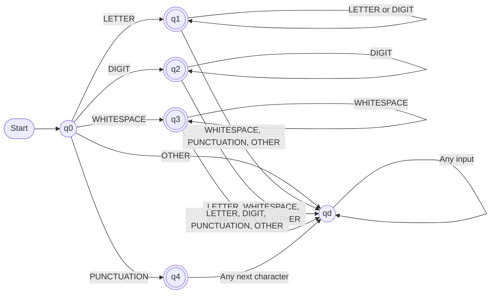

# Group 3: Tokenizer State Machine (Mini Lexer)

## DFA Design and Transition Table

## 1. Objective

The objective of this project is to develop a Tokenizer State Machine (Mini Lexer) using Python to process source input, identify different types of tokens, and organize them for further processing.

The project uses a Deterministic Finite Automaton (DFA) to recognize token patterns such as identifiers, integers, whitespace, and punctuation. The lexer reads input character by character, applies transition rules, identifies token boundaries, and produces a sequence of tokens.

This project demonstrates the application of finite automata and lexical analysis in a simple tokenization system.

## 2. Character Classes

The input characters are classified into the following categories.

| Character Class | Description | Examples |
|---|---|---|
| `LETTER` | Alphabetic characters and underscore | `a`, `Z`, `_` |
| `DIGIT` | Numeric digits | `0`, `7`, `9` |
| `WHITESPACE` | Spaces, tabs, and newlines | space, `\t`, `\n` |
| `PUNCTUATION` | Supported punctuation characters and operators | `;`, `+`, `(`, `)`, `=` |
| `OTHER` | Characters outside the supported classes | Unsupported symbols |

Each input character is classified before the DFA determines the next state.

## 3. DFA Design

### 3.1 States

The DFA consists of six states.

| State | Description | Accepting? |
|---|---|---|
| `q0` | Initial state | No |
| `q1` | Recognizes identifiers | Yes |
| `q2` | Recognizes integers | Yes |
| `q3` | Recognizes whitespace sequences | Yes |
| `q4` | Recognizes one punctuation character | Yes |
| `qd` | Dead state for invalid input or continuation | No |

### 3.2 Initial State

The initial state is `q0`. Each new token recognition attempt begins at this state.

### 3.3 DFA State Diagram

The following diagram illustrates the states and transitions of the DFA.

**Diagram notation:**

- `q0` is the initial state.
- `q1`, `q2`, `q3`, and `q4` are accepting states.
- `qd` is the dead state.
- Arrows represent transitions triggered by input character classes.
- Loops represent transitions that keep the DFA in the same state.

### 3.4 Transition Rules

- From `q0`, a letter leads to `q1`.
- From `q0`, a digit leads to `q2`.
- From `q0`, whitespace leads to `q3`.
- From `q0`, punctuation leads to `q4`.
- From `q0`, an unsupported character leads to `qd`.
- In `q1`, letters and digits continue an identifier.
- In `q2`, digits continue an integer.
- In `q3`, whitespace characters continue a whitespace sequence.
- In `q4`, the punctuation character completes the token.
- In `qd`, all further input remains in the dead state.

## 4. DFA Transition Table

Each cell specifies the next state for the current state and input character class.

| Current State | `LETTER` | `DIGIT` | `WHITESPACE` | `PUNCTUATION` | `OTHER` |
|---|---|---|---|---|---|
| `q0` | `q1` | `q2` | `q3` | `q4` | `qd` |
| `q1` | `q1` | `q1` | `qd` | `qd` | `qd` |
| `q2` | `qd` | `q2` | `qd` | `qd` | `qd` |
| `q3` | `qd` | `qd` | `q3` | `qd` | `qd` |
| `q4` | `qd` | `qd` | `qd` | `qd` | `qd` |
| `qd` | `qd` | `qd` | `qd` | `qd` | `qd` |

### 4.1 Transition Notation

The main transitions can be represented as follows:

- `q0 -- LETTER --> q1`
- `q0 -- DIGIT --> q2`
- `q0 -- WHITESPACE --> q3`
- `q0 -- PUNCTUATION --> q4`
- `q0 -- OTHER --> qd`
- `q1 -- LETTER/DIGIT --> q1`
- `q2 -- DIGIT --> q2`
- `q3 -- WHITESPACE --> q3`

All other transitions lead to `qd`. The dead state loops to itself for every input class.

## 5. Accepting States

The set of accepting states is:

`F = {q1, q2, q3, q4}`

- `q1` accepts identifiers.
- `q2` accepts integers.
- `q3` accepts whitespace sequences.
- `q4` accepts one punctuation character.

The initial state `q0` and the dead state `qd` are not accepting states.

An input token is accepted when its recognition ends in one of the accepting states.

## 6. Example: Recognizing an Identifier

**Input:** `count42`

| Input Character | Character Class | State After Reading |
|---|---|---|
| Start | — | `q0` |
| `c` | `LETTER` | `q1` |
| `o` | `LETTER` | `q1` |
| `u` | `LETTER` | `q1` |
| `n` | `LETTER` | `q1` |
| `t` | `LETTER` | `q1` |
| `4` | `DIGIT` | `q1` |
| `2` | `DIGIT` | `q1` |

**Final state:** `q1`

**Result:** `IDENTIFIER("count42")`

The identifier is accepted because `q1` allows letters and digits.

## 7. Example: Recognizing an Integer

**Input:** `123`

| Input Character | Character Class | State After Reading |
|---|---|---|
| Start | — | `q0` |
| `1` | `DIGIT` | `q2` |
| `2` | `DIGIT` | `q2` |
| `3` | `DIGIT` | `q2` |

**Final state:** `q2`

**Result:** `INTEGER("123")`

The integer is accepted because `q2` allows consecutive digits.

## 8. Example: Tokenizing an Expression

**Input:** `count = 123;`

Expected token sequence:

1. `IDENTIFIER("count")`
2. `PUNCTUATION("=")`
3. `INTEGER("123")`
4. `PUNCTUATION(";")`

Whitespace between tokens can be skipped by the lexer.

The lexer detects token boundaries, emits completed tokens, and begins recognition of the next token from `q0`. Separators between tokens are handled by the lexer rather than treated automatically as invalid input.

## 9. Relationship Between DFA and Lexer

1. The lexer reads source input from left to right.
2. Each character is classified into a supported character class.
3. The DFA determines the next state using the current state and input class.
4. The lexer collects characters that match a valid token pattern.
5. When a token boundary is reached, the lexer emits the completed token.
6. The lexer begins recognition of the next token from `q0`.
7. Whitespace tokens may be skipped according to the lexer rules.

The DFA recognizes token patterns, while the lexer manages token boundaries and produces the sequence of tokens.

## 10. Limitations

- Only integer numbers are supported; decimal numbers require additional states or rules.
- Quoted strings and comments are not implemented.
- Only explicitly supported punctuation characters and operators are recognized.
- Token boundaries and invalid input must be handled by the lexer.
- This is a simplified educational model and is not a complete LLM tokenizer.
